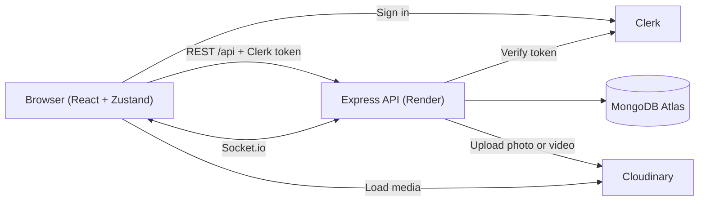

# ChatTime

A real-time chat web app. Sign in, find people by name or email, and chat live with text, photos and videos, with unread badges and notifications.

**Live demo:** https://chat-time-app.vercel.app

> The backend runs on a free hosting plan and sleeps when idle. The first load after a break can take about 30 seconds.

## Screenshots

| Chat list with unread badge | Photo in a chat | Phone view |
| --- | --- | --- |
|  |  |  |

## Features

- **Authentication** with Clerk: sign up, sign in, sign out, protected routes, profile page
- **Find people** by name or email and start a one-to-one chat
- **Real-time messaging** with Socket.io, with live online status
- **Photos and videos** in messages (uploaded to Cloudinary), with a full-screen photo viewer
- **Unread badges** stored in the database, cleared when you open a chat
- **Notifications:** sound (with mute button), toast for chats that are not open, unread count in the tab title, and browser notifications
- **Responsive layout** for desktop and phone
- Loading skeletons, empty states and error toasts

## Tech stack

| Area | Technologies |
| --- | --- |
| Frontend | React (Vite), React Router, Zustand, Tailwind CSS, Axios, Socket.io client, react-hot-toast, lucide-react |
| Backend | Node.js, Express, Socket.io, Mongoose, Multer |
| Database | MongoDB Atlas |
| Auth | Clerk |
| Media | Cloudinary |
| Hosting | Vercel (frontend), Render (backend) |

## Architecture



- The frontend sends the Clerk session token with every API request and when it opens the socket connection.
- The backend verifies the token, loads the matching user from MongoDB, and then handles the request.
- Messages are sent over REST. The server then pushes them live to the other person over Socket.io.

## Project structure

```
backend/src
  config/        database and Cloudinary setup
  controllers/   user, conversation and message logic
  middleware/    Clerk auth and file upload checks
  models/        User, Conversation, Message
  routes/        API routes
  socket/        Socket.io server
  index.js       app entry point
frontend/src
  components/    Sidebar, ChatWindow, MessageInput, Avatar, ...
  pages/         Home, Login, Signup, Profile
  lib/           API client, socket, sound, notifications, helpers
  stores/        Zustand stores (chat, user, socket, settings)
```

## Database overview

**User**: Clerk id, name and username, email, avatar, last seen

**Conversation**: the two participants, last message text, unread count per user, timestamps

**Message**: conversation, sender, text (max 500 characters), optional media URL and type (`image` or `video`), timestamps

## API overview

All routes except the health check need a Clerk token in the `Authorization: Bearer` header.

| Method | Route | Purpose |
| --- | --- | --- |
| GET | `/api/health` | Health check (public) |
| GET | `/api/users/me` | Current user, created in MongoDB on first sign-in |
| GET | `/api/users/search?q=` | Find people by name or email |
| POST | `/api/conversations` | Start or get a chat with a user |
| GET | `/api/conversations` | My chats |
| GET | `/api/conversations/:id/messages` | Messages of a chat |
| PATCH | `/api/conversations/:id/read` | Mark a chat as read |
| POST | `/api/messages` | Send a message (text and/or media) |
| POST | `/api/messages/upload` | Upload a photo or video, returns its URL and type |

Upload limits: photos up to 10 MB (JPG, PNG, WEBP, GIF), videos up to 50 MB (MP4, WEBM, MOV).

## Socket.io events

The socket connection is authenticated with the same Clerk token.

| Event | Direction | Payload |
| --- | --- | --- |
| `onlineUsers` | server to client | List of online user ids |
| `newMessage` | server to client | The message and its conversation |

## Run it locally

You need Node.js 20 or newer, a free MongoDB Atlas cluster, a Clerk application and a Cloudinary account.

```bash
git clone https://github.com/FongDev-star/chat_time.git
cd chat_time
```

**Backend** (runs on port 5001)

```bash
cd backend
npm install
```

Create `backend/.env`:

```
PORT=5001
CLIENT_URL=http://localhost:5173
CLERK_PUBLISHABLE_KEY=your_clerk_publishable_key
CLERK_SECRET_KEY=your_clerk_secret_key
MONGO_URI=your_mongodb_connection_string
CLOUDINARY_CLOUD_NAME=your_cloud_name
CLOUDINARY_API_KEY=your_api_key
CLOUDINARY_API_SECRET=your_api_secret
```

```bash
npm run dev
```

**Frontend** (runs on port 5173)

```bash
cd frontend
npm install
```

Create `frontend/.env`:

```
VITE_CLERK_PUBLISHABLE_KEY=your_clerk_publishable_key
VITE_API_URL=http://localhost:5001/api
VITE_SOCKET_URL=http://localhost:5001
```

```bash
npm run dev
```

Open http://localhost:5173. In MongoDB Atlas, allow your IP address under Network Access.

## Deployment

- **Backend on Render:** Web Service, root directory `backend`, build command `npm install`, start command `npm start`. Add the backend variables above in the Environment settings, and set `CLIENT_URL` to the exact frontend address (https, no trailing slash).
- **Frontend on Vercel:** root directory `frontend`. Add the three `VITE_` variables, and redeploy after changing them, because Vite reads them at build time. `frontend/vercel.json` makes page links such as `/profile` work after a refresh.

Never commit `.env` files or put secret keys in a `VITE_` variable. Everything with a `VITE_` prefix is visible in the browser.

## Roadmap

- Read receipts ("seen")
- Push notifications when the site is closed
- Date separators and "last seen" in the chat
- Automated tests

## Author

Vorn Sivfong